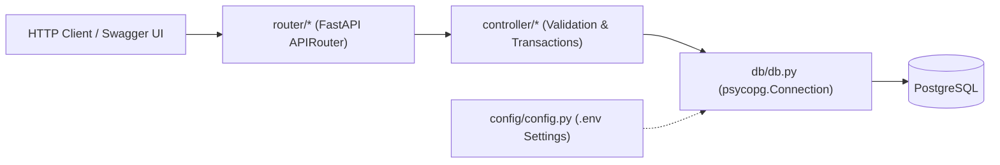

# Architecture, Security & Implementation Roadmap

This document describes the structure of the `src/bank` package, layer boundaries, security controls, and step-by-step roadmap for building out the remaining banking features.

---

## 1. Repository Layout

```text
Bank/
├── .env.example                       # Sample environment variables (safe to commit)
├── .gitignore                         # Ignores .env, .venv/, __pycache__/, .pytest_cache/
├── .python-version                    # Pins Python 3.15
├── LICENCE                            # MIT License
├── pyproject.toml                     # uv/PEP 621 project metadata & dependencies
├── uv.lock                            # Locked dependency tree
├── README.md                          # Main project overview & specification hub
├── setup.md                           # uv, PostgreSQL, .env & VS Code setup guide
├── docs/
│   ├── schema.sql                     # Executable PostgreSQL DDL
│   ├── database.md                    # ER model, tables, and SQL workflows
│   ├── api.md                         # REST API specification (implemented + planned)
│   ├── workflows.md                   # Transaction & concurrency safety flows
│   └── architecture.md                # This file
└── src/
    └── bank/
        ├── __init__.py                # FastAPI app instance & router registration
        ├── config/
        │   └── config.py              # Pydantic Settings loader for .env (POSTGRES_CONFIG)
        ├── db/
        │   └── db.py                  # PostgreSQL connection factory (psycopg v3)
        ├── controller/
        │   └── user_controller.py     # Business logic, Pydantic schemas & SQL queries
        └── router/
            └── user_router.py         # FastAPI APIRouter endpoints (/users)
```

---

## 2. Layered Architecture

The codebase follows a clean **Router → Controller → Database → Config** separation:



| Layer | File(s) | Responsibilities |
|---|---|---|
| **App Entry** | [`src/bank/__init__.py`](../src/bank/__init__.py) | Instantiates `app = FastAPI()` and mounts routers |
| **Config** | [`src/bank/config/config.py`](../src/bank/config/config.py) | Loads `POSTGRES_CONFIG` from `.env` via `pydantic-settings` |
| **Database** | [`src/bank/db/db.py`](../src/bank/db/db.py) | Provides `get_connection() -> psycopg.Connection` |
| **Router** | [`src/bank/router/user_router.py`](../src/bank/router/user_router.py) | Defines HTTP verbs, paths, status codes, and response models |
| **Controller** | [`src/bank/controller/user_controller.py`](../src/bank/controller/user_controller.py) | Input validation, password hashing, DB transaction orchestration, error mapping |

### Recommended Module Expansion

As you implement the remaining features, follow the existing convention:

- **`src/bank/router/`**
  - `user_router.py`: `/users/register`, `/users/me` (Account Details Show, Update, Deactivate)
  - `auth_router.py`: `/auth/login` (authentication)
  - `account_router.py` (or `transaction_router.py`): `/users/me/balance`, `/users/me/add-money`, `/users/me/transactions`, `/users/me/transfer`
- **`src/bank/controller/`**
  - `user_controller.py`: registration, profile read/update, account details aggregation
  - `auth_controller.py`: password verification (`scrypt` constant-time `secrets.compare_digest`), token issuance
  - `transaction_controller.py`: atomic Add Money, Credit, Debit, Transfer Money, Bank Balance, and History queries

---

## 3. Security Controls

### Implemented Today
- **Strong Password Hashing**: [`_hash_password`](../src/bank/controller/user_controller.py#L34-L37) uses `hashlib.scrypt` (`n=2**14, r=8, p=1`) with a unique 16-byte random salt (`secrets.token_bytes(16)`).
- **Parameterized SQL**: All SQL statements pass values via `%s` bind parameters (`psycopg`), preventing SQL injection.
- **No Credential Leakage**: `RegisteredUserResponse` returns only `id`, `email`, and `display_name`; `password_hash` and `POSTGRES_CONFIG` are never returned or logged.
- **Minimum Password Length**: `RegisterUserRequest` enforces `min_length=12`, `max_length=128` and strips/lowercases emails.

### Required Before Production / Deployment
- **Authentication & Authorization**: Protect all `/users/me/*` routes so a user can only read/mutate their own balance and transactions.
- **Constant-Time Password Verification**: Use `hmac.compare_digest` / `secrets.compare_digest` when verifying `scrypt` digests during login.
- **Idempotency Keys**: Enforce `Idempotency-Key` checks on `add-money`, `transactions`, and `transfer` to eliminate duplicate money movement on retries.
- **Connection Pooling**: Replace per-request `psycopg.connect(...)` with `psycopg_pool.ConnectionPool` under load.
- **Rate Limiting & Structured Logging**: Apply rate limits on `/auth/login`, `/users/register`, and `/users/me/transfer`, ensuring logs redact tokens, passwords, and DB DSNs.

---

## 4. Implementation Order

Follow this sequence to build the complete application cleanly:

1. **PostgreSQL & Env Setup**: Verify local PostgreSQL and apply [`docs/schema.sql`](schema.sql) (see [`setup.md`](../setup.md)).
2. **Authentication**: Implement `POST /auth/login` and a FastAPI dependency (`get_current_user`) verifying signed bearer tokens/sessions.
3. **Account Details Show & Bank Balance**: Implement `GET /users/me` and `GET /users/me/balance` joining `user_acc` and `user_balance`.
4. **Profile Update & Soft Deactivation**: Implement `PATCH /users/me` and `DELETE /users/me` (`is_active = FALSE`).
5. **Add Money & Credit/Debit**: Implement `POST /users/me/add-money` and `POST /users/me/transactions` using `Decimal`, `FOR UPDATE` row locking, and atomic ledger inserts.
6. **Transfer Money**: Implement `POST /users/me/transfer` with deterministic `ORDER BY user_id ASC FOR UPDATE` locking and paired `balance_transactions` entries.
7. **Transaction History**: Implement `GET /users/me/transactions` with keyset cursor pagination and `limit` cap (`<= 100`).
8. **Automated Testing**: Add `pytest` + `httpx` tests covering every acceptance criterion.

---

## 5. Testing Checklist

Ensure automated tests cover at least these critical cases:

- [ ] **Duplicate Registration**: Registering an existing email returns `409 Conflict` without corrupting balances.
- [ ] **Atomic Registration**: Every newly registered user starts with exactly one `user_balance` row set to `0.00`.
- [ ] **Account Details Show & Balance Read**: Returns exact `NUMERIC(12, 2)` balance and excludes `password_hash`.
- [ ] **Amount Validation**: `0`, negative numbers, non-numeric strings, and `> 2` decimal places fail with `422`.
- [ ] **Add Money & Credit**: Increases balance and inserts a matching `credit` row atomically.
- [ ] **Insufficient Funds Debit**: Debit exceeding balance returns `409 Conflict` and leaves balance + history unchanged.
- [ ] **Concurrent Debits**: Two simultaneous debits totaling more than the balance result in one success and one `409 Conflict` (no negative balance).
- [ ] **Transfer Money Atomicity**: Sender decreases, receiver increases, and two paired rows share `reference_id`.
- [ ] **Concurrent Bidirectional Transfers**: Simultaneous `A → B` and `B → A` transfers complete without deadlocks (`40P01`).
- [ ] **Self-Transfer & Inactive Recipient**: Rejected cleanly without changing balances.
- [ ] **Rollback Guarantee**: Induced failure during ledger `INSERT` rolls back the `user_balance` `UPDATE`.
- [ ] **Deactivation Preserves History**: Setting `is_active = FALSE` blocks transactions while preserving `balance_transactions` rows.

---

## 6. Important Limitations

This three-table architecture is designed as a **learning and demonstration project**, not a regulated production banking ledger. Production financial systems additionally require immutable double-entry accounting across system/clearing accounts, payment gateway reconciliation, outbox/event streaming, regulatory audit trails, fraud monitoring, automated encrypted backups, and formal compliance controls. **Do not use this demo design to hold or move real customer funds.**
