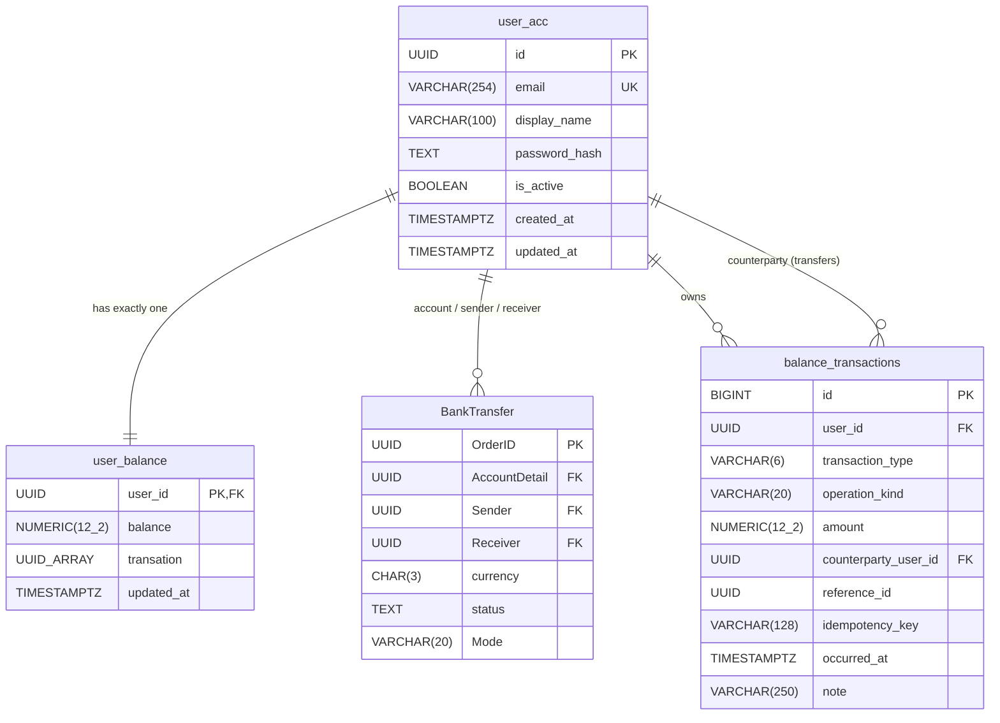

# Database Design & SQL Cookbook

This project uses **PostgreSQL** with a four-table relational schema defined in [`docs/schema.sql`](schema.sql) (along with Python schema helpers in [`src/bank/api/User Balance/UserBallanceSchema.py`](../src/bank/api/User%20Balance/UserBallanceSchema.py) and [`src/bank/api/BankTransfer/BankTransferSchema.py`](../src/bank/api/BankTransfer/BankTransferSchema.py)).

---

## 1. Entity Relationship Diagram



### Cardinality Summary

- **`user_acc` (1) ─── (1) `user_balance`**: Every active user has one balance row created atomically during registration, with `transation` holding an array of `BankTransfer(OrderID)` UUIDs.
- **`user_acc` (1) ─── (\*) `BankTransfer`**: Transfer orders linking `AccountDetail`, `Sender`, and `Receiver` to `user_acc(id)`.
- **`user_acc` (1) ─── (\*) `balance_transactions`**: Append-only financial ledger recording every **Add Money**, **Credit**, **Debit**, and **Transfer Money** event.

---

## 2. Table Definitions

### `user_acc` — Account & Profile Identity

| Column | Type | Constraints | Purpose |
|---|---|---|---|
| `id` | `UUID` | `PRIMARY KEY DEFAULT gen_random_uuid()` | Unique account identifier |
| `email` | `VARCHAR(254)` | `NOT NULL UNIQUE` | Normalized lowercase login/account email |
| `display_name` | `VARCHAR(100)` | `NOT NULL` | Account holder display name |
| `password_hash` | `TEXT` | `NOT NULL` | Salted `scrypt` hash (`scrypt$<salt>$<digest>`); never returned in responses |
| `is_active` | `BOOLEAN` | `NOT NULL DEFAULT TRUE` | Soft-deactivation flag (`FALSE` blocks transactions without deleting history) |
| `created_at` | `TIMESTAMPTZ` | `NOT NULL DEFAULT now()` | Account creation timestamp |
| `updated_at` | `TIMESTAMPTZ` | `NOT NULL DEFAULT now()` | Last profile update timestamp |

### `user_balance` — Current Bank Balance

| Column | Type | Constraints | Purpose |
|---|---|---|---|
| `user_id` | `UUID` | `PRIMARY KEY REFERENCES user_acc(id) ON DELETE RESTRICT` | One-to-one link to account |
| `balance` | `NUMERIC(12, 2)` | `NOT NULL DEFAULT 0.00 CHECK (balance >= 0)` | Current balance in rupees (nonnegative; prevents overdrafts) |
| `transation` | `UUID[]` | `NOT NULL DEFAULT '{}'` | Array of `BankTransfer(OrderID)` UUIDs associated with this balance (validated in application transactions since PostgreSQL does not support `FOREIGN KEY` constraints on array elements) |
| `updated_at` | `TIMESTAMPTZ` | `NOT NULL DEFAULT now()` | Timestamp of the last balance mutation |

### `BankTransfer` — Transfer Orders

| Column | Type | Constraints | Purpose |
|---|---|---|---|
| `OrderID` | `UUID` | `PRIMARY KEY` | Unique transfer order identifier |
| `AccountDetail` | `UUID` | `REFERENCES user_acc(id)` | Account associated with the transfer |
| `Sender` | `UUID` | `NULL REFERENCES user_acc(id)` | Sending user account ID |
| `Receiver` | `UUID` | `NULL REFERENCES user_acc(id)` | Receiving user account ID |
| `currency` | `CHAR(3)` | `NOT NULL DEFAULT 'INR'` | ISO 4217 currency code |
| `status` | `TEXT` | `NOT NULL DEFAULT 'pending' CHECK (status IN ('pending','posted','reversed','failed'))` | Transfer lifecycle status |
| `Mode` | `VARCHAR(20)` | `NULL` | Transfer channel / payment mode |

### `balance_transactions` — Append-Only Financial Ledger

| Column | Type | Constraints | Purpose |
|---|---|---|---|
| `id` | `BIGINT` | `GENERATED ALWAYS AS IDENTITY PRIMARY KEY` | Monotonic entry ID for stable cursor pagination |
| `user_id` | `UUID` | `NOT NULL REFERENCES user_acc(id) ON DELETE RESTRICT` | Account whose balance was affected |
| `transaction_type` | `VARCHAR(6)` | `NOT NULL CHECK (transaction_type IN ('credit', 'debit'))` | Direction of balance change (`+` or `-`) |
| `operation_kind` | `VARCHAR(20)` | `NOT NULL DEFAULT 'credit' CHECK (operation_kind IN ('add_money', 'credit', 'debit', 'transfer'))` | Business action that created the ledger row |
| `amount` | `NUMERIC(12, 2)` | `NOT NULL CHECK (amount > 0)` | Always strictly positive; direction comes from `transaction_type` |
| `counterparty_user_id` | `UUID` | `REFERENCES user_acc(id) ON DELETE RESTRICT` | For transfers, the other participant; `NULL` otherwise; `CHECK (counterparty_user_id IS NULL OR counterparty_user_id <> user_id)` |
| `reference_id` | `UUID` | `NULL` | Shared correlation UUID linking sender `debit` and receiver `credit` legs of a transfer |
| `idempotency_key` | `VARCHAR(128)` | `NULL` | Client-supplied key preventing duplicate writes on network retries |
| `occurred_at` | `TIMESTAMPTZ` | `NOT NULL DEFAULT now()` | Event timestamp |
| `note` | `VARCHAR(250)` | `NULL` | Optional human-readable memo |

### Indexes

- `balance_transactions_user_date_idx (user_id, occurred_at DESC, id DESC)`: Fast history pagination newest-first.
- `balance_transactions_reference_idx (reference_id) WHERE reference_id IS NOT NULL`: Fast lookup of both legs of a transfer.
- `balance_transactions_idempotency_uidx (user_id, idempotency_key) WHERE idempotency_key IS NOT NULL`: Unique constraint enforcing idempotent retries per user.

---

## 3. Financial Precision & Safety Rules

1. **Exact Decimal Arithmetic**: Always use `NUMERIC(12, 2)` in PostgreSQL and `decimal.Decimal` in Python. Never use `FLOAT` or `REAL` for money.
2. **Positive Amounts Only**: `amount` is always `> 0`. `transaction_type` (`credit` or `debit`) determines sign.
3. **Immutable Ledger**: Never `UPDATE` or `DELETE` posted rows in `balance_transactions`. Corrections must be issued as a new compensating transaction.
4. **Row Locking (`FOR UPDATE`)**: Lock `user_balance` before computing or mutating balances so concurrent requests cannot race.
5. **Non-Cascading Account Closure**: `ON DELETE RESTRICT` protects financial history; deactivate accounts with `is_active = FALSE` instead of deleting `user_acc`.

---

## 4. Upgrading an Existing Minimal Schema

If `user_acc`, `user_balance`, and the earlier minimal `balance_transactions` already exist, do **not** drop `user_acc`. Add only the missing columns and indexes safely:

```sql
ALTER TABLE user_balance
    ADD COLUMN IF NOT EXISTS transation UUID[] NOT NULL DEFAULT '{}';

ALTER TABLE balance_transactions
    ADD COLUMN IF NOT EXISTS operation_kind VARCHAR(20) NOT NULL DEFAULT 'credit'
        CHECK (operation_kind IN ('add_money', 'credit', 'debit', 'transfer')),
    ADD COLUMN IF NOT EXISTS counterparty_user_id UUID REFERENCES user_acc(id) ON DELETE RESTRICT,
    ADD COLUMN IF NOT EXISTS reference_id UUID,
    ADD COLUMN IF NOT EXISTS idempotency_key VARCHAR(128);

CREATE INDEX IF NOT EXISTS balance_transactions_reference_idx
    ON balance_transactions (reference_id)
    WHERE reference_id IS NOT NULL;

CREATE UNIQUE INDEX IF NOT EXISTS balance_transactions_idempotency_uidx
    ON balance_transactions (user_id, idempotency_key)
    WHERE idempotency_key IS NOT NULL;
```

---

## 5. Atomic SQL Workflows

> **Important:** Always use parameterized queries (`%s` placeholders in `psycopg`). Never interpolate user input directly into SQL strings.

### 5.1 User Registration (Implemented in `src/bank/api/Account/AccountService.py`)

Creates the user and zero-balance row in one transaction:

```sql
BEGIN;

INSERT INTO user_acc (email, display_name, password_hash)
VALUES (%s, %s, %s)
RETURNING id, email, display_name;

INSERT INTO user_balance (user_id, balance)
VALUES (%s, 0.00);

COMMIT;
```

### 5.2 Account Details Show

Fetches profile metadata, active status, current balance, and recent transaction count in one query:

```sql
SELECT
    u.id,
    u.email,
    u.display_name,
    u.is_active,
    u.created_at,
    u.updated_at AS profile_updated_at,
    b.balance,
    b.updated_at AS balance_updated_at,
    (
        SELECT COUNT(*)
        FROM balance_transactions bt
        WHERE bt.user_id = u.id
    ) AS total_transactions
FROM user_acc AS u
JOIN user_balance AS b ON b.user_id = u.id
WHERE u.id = :user_id
  AND u.is_active = TRUE;
```

### 5.3 Bank Balance Check

```sql
SELECT u.id, u.display_name, b.balance, b.updated_at
FROM user_acc AS u
JOIN user_balance AS b ON b.user_id = u.id
WHERE u.id = :user_id
  AND u.is_active = TRUE;
```

### 5.4 Add Money / Credit Workflow

Both **Add Money** (`operation_kind = 'add_money'`) and general **Credit** (`operation_kind = 'credit'`) increase `user_balance` and append a `credit` row atomically:

```sql
BEGIN;

-- 1. Ensure user is active and lock balance row
SELECT b.balance
FROM user_balance AS b
JOIN user_acc AS u ON u.id = b.user_id
WHERE b.user_id = :user_id
  AND u.is_active = TRUE
FOR UPDATE OF b;

-- Application verifies row exists and :amount > 0.00 (max 2 decimal places).

-- 2. Increase balance
UPDATE user_balance
SET balance = balance + :amount,
    updated_at = now()
WHERE user_id = :user_id
RETURNING balance, updated_at;

-- 3. Record immutable credit ledger row
INSERT INTO balance_transactions (
    user_id,
    transaction_type,
    operation_kind,
    amount,
    idempotency_key,
    note
)
VALUES (
    :user_id,
    'credit',
    :operation_kind,  -- 'add_money' or 'credit'
    :amount,
    :idempotency_key,
    :note
)
RETURNING id, transaction_type, operation_kind, amount, occurred_at, note;

COMMIT;
```

### 5.5 Debit Workflow (With Overdraft Protection)

Locks the balance row, verifies sufficient funds, subtracts `:amount`, and appends a `debit` row:

```sql
BEGIN;

-- 1. Lock user's balance row
SELECT b.balance
FROM user_balance AS b
JOIN user_acc AS u ON u.id = b.user_id
WHERE b.user_id = :user_id
  AND u.is_active = TRUE
FOR UPDATE OF b;

-- Application verifies row exists, :amount > 0, and balance >= :amount.

-- 2. Deduct atomically with conditional balance guard
UPDATE user_balance
SET balance = balance - :amount,
    updated_at = now()
WHERE user_id = :user_id
  AND balance >= :amount
RETURNING balance, updated_at;

-- Application verifies exactly 1 row updated; otherwise ROLLBACK and return 409 / 400.

-- 3. Record immutable debit ledger row
INSERT INTO balance_transactions (
    user_id,
    transaction_type,
    operation_kind,
    amount,
    idempotency_key,
    note
)
VALUES (
    :user_id,
    'debit',
    'debit',
    :amount,
    :idempotency_key,
    :note
)
RETURNING id, transaction_type, operation_kind, amount, occurred_at, note;

COMMIT;
```

### 5.6 Transfer Money Workflow (Deadlock-Safe Dual Locking)

A **Transfer Money** operation moves funds from `:sender_id` to `:receiver_id` in **one atomic database transaction**.

To prevent deadlocks when User A transfers to User B at the exact same moment User B transfers to User A, **always lock both `user_balance` rows in deterministic `user_id` order (`ORDER BY user_id ASC`)**:

```sql
BEGIN;

-- Application first verifies :sender_id <> :receiver_id and :amount > 0.00.

-- 1. Lock BOTH active accounts' balance rows in deterministic UUID ascending order
SELECT b.user_id, b.balance
FROM user_balance AS b
JOIN user_acc AS u ON u.id = b.user_id
WHERE b.user_id IN (:sender_id, :receiver_id)
  AND u.is_active = TRUE
ORDER BY b.user_id ASC
FOR UPDATE OF b;

-- Application verifies:
--   * Exactly 2 rows returned (both sender and receiver exist and are active).
--   * Sender row has balance >= :amount.

-- 2. Debit sender
UPDATE user_balance
SET balance = balance - :amount,
    updated_at = now()
WHERE user_id = :sender_id
  AND balance >= :amount
RETURNING balance;

-- 3. Credit receiver
UPDATE user_balance
SET balance = balance + :amount,
    updated_at = now()
WHERE user_id = :receiver_id
RETURNING balance;

-- 4. Insert paired ledger entries linked by :reference_id (generated UUID)
INSERT INTO balance_transactions (
    user_id, transaction_type, operation_kind, amount, counterparty_user_id, reference_id, idempotency_key, note
)
VALUES
    (:sender_id,   'debit',  'transfer', :amount, :receiver_id, :reference_id, :idempotency_key, :sender_note),
    (:receiver_id, 'credit', 'transfer', :amount, :sender_id,   :reference_id, NULL,             :receiver_note);

COMMIT;
```

> If **any** step fails (insufficient balance, inactive receiver, missing row, constraint error, or duplicate `idempotency_key`), the entire transaction rolls back cleanly — neither balance changes and no partial ledger rows are saved.

### 5.7 Paginated Transaction History (Cursor-Based, Newest First)

First page:

```sql
SELECT id, transaction_type, operation_kind, amount, counterparty_user_id, reference_id, occurred_at, note
FROM balance_transactions
WHERE user_id = :user_id
ORDER BY occurred_at DESC, id DESC
LIMIT :limit;
```

Next page (using the last item's `(occurred_at, id)` as keyset cursor — avoids `OFFSET` drift when new transactions arrive):

```sql
SELECT id, transaction_type, operation_kind, amount, counterparty_user_id, reference_id, occurred_at, note
FROM balance_transactions
WHERE user_id = :user_id
  AND (occurred_at, id) < (:cursor_occurred_at, :cursor_id)
ORDER BY occurred_at DESC, id DESC
LIMIT :limit;
```

### 5.8 Ledger Integrity Reconciliation Check

Every user's stored balance should always equal `SUM(credits) - SUM(debits)`:

```sql
SELECT
    b.user_id,
    b.balance AS stored_balance,
    COALESCE(SUM(CASE WHEN t.transaction_type = 'credit' THEN t.amount ELSE -t.amount END), 0.00) AS ledger_balance,
    b.balance - COALESCE(SUM(CASE WHEN t.transaction_type = 'credit' THEN t.amount ELSE -t.amount END), 0.00) AS discrepancy
FROM user_balance AS b
LEFT JOIN balance_transactions AS t ON t.user_id = b.user_id
GROUP BY b.user_id, b.balance
HAVING b.balance <> COALESCE(SUM(CASE WHEN t.transaction_type = 'credit' THEN t.amount ELSE -t.amount END), 0.00);
```

Zero rows returned means 100% balance-to-ledger consistency.
