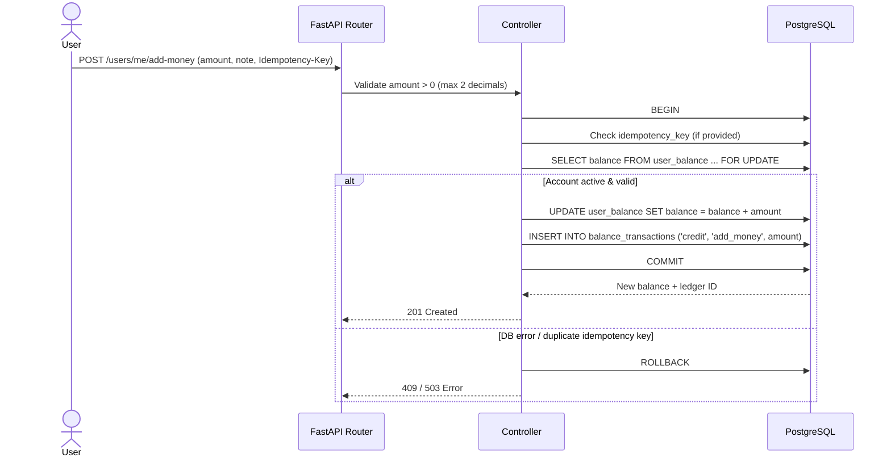
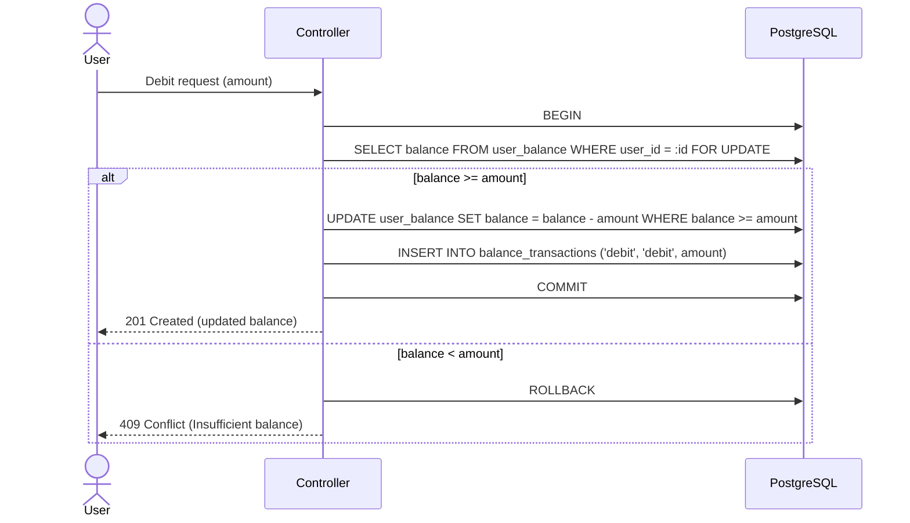
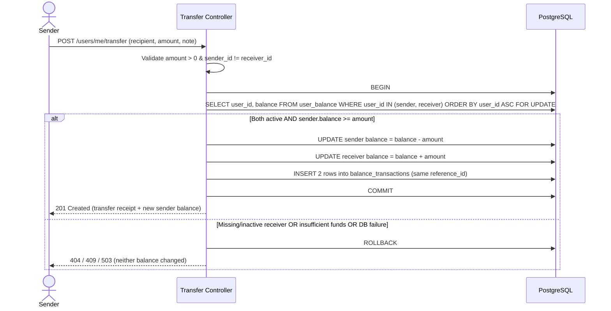

# Banking Operation Workflows & Concurrency Safety

This document details how each core banking operation executes end-to-end across the **FastAPI router → controller → PostgreSQL transaction** pipeline, ensuring balance consistency and race-condition safety.

---

## 1. Operation Comparison Overview

| Operation | Balance Effect | `transaction_type` | `operation_kind` | Row Locking | Failure Mode |
|---|---|---|---|---|---|
| **Account Details Show** | Read-only | — | — | None | `401` / `404` if inactive |
| **Bank Balance** | Read-only | — | — | None | `401` / `404` if inactive |
| **Add Money** | `balance + amount` | `credit` | `add_money` | `FOR UPDATE` on 1 row | Validation / DB error |
| **Credit** | `balance + amount` | `credit` | `credit` | `FOR UPDATE` on 1 row | Validation / DB error |
| **Debit** | `balance - amount` | `debit` | `debit` | `FOR UPDATE` on 1 row | `409` if `balance < amount` |
| **Transfer Money** | Sender `- amount`, Receiver `+ amount` | `debit` (sender) + `credit` (receiver) | `transfer` | `FOR UPDATE` on 2 rows (`ORDER BY user_id ASC`) | Rollback both if any check fails |

---

## 2. User Registration *(Implemented)*

Executed in [`register_user`](../src/bank/controller/user_controller.py#L13-L59):

1. [`RegisterUserRequest`](../src/bank/validators/user_validator.py#L6-L19) validates and normalizes `email` (trimmed + lowercased), `display_name`, and `password` (`>= 12` chars).
2. [`hash_password`](../src/bank/utils/auth_utils.py#L5-L8) generates a 16-byte random salt via `secrets.token_bytes(16)` and hashes with `hashlib.scrypt` (`n=16384, r=8, p=1`).
3. Opens one database transaction (`with get_connection() as connection:`):
   - Inserts into `user_acc` and returns `(id, email, display_name)`.
   - Inserts `(user_id, 0.00)` into `user_balance`.
4. Commits automatically when the `with` block exits cleanly; rolls back if `UniqueViolation` (`409`) or `psycopg.Error` (`503`) occurs.

---

## 3. Account Details Show & Bank Balance

### Account Details Show (`GET /users/me`)
1. Authenticate caller from bearer token / session (`user_id`).
2. Query `user_acc` joined with `user_balance` where `u.id = :user_id AND u.is_active = TRUE`.
3. Include summary count/recent metadata if needed.
4. Strip/exclude `password_hash` at the SQL `SELECT` and Pydantic response model levels.

### Bank Balance (`GET /users/me/balance`)
1. Authenticate caller (`user_id`).
2. Read `balance` and `updated_at` from `user_balance` joined with `user_acc` (`is_active = TRUE`).
3. Serialize `balance` cleanly as exact decimal (`NUMERIC(12, 2)`).

---

## 4. Add Money & Credit Flows

**Add Money** is the user-facing deposit action (`operation_kind = 'add_money'`). **Credit** is the general inward-funds ledger action (`operation_kind = 'credit'`). Both mutate `user_balance` and `balance_transactions` atomically:

---

## 5. Debit Flow (Overdraft Protection)

A debit must **never** push `user_balance.balance` below `0.00`. Protection is enforced at **three layers**:
1. **API validation**: `amount > 0` with max 2 decimal places.
2. **Application guard inside `FOR UPDATE` transaction**: verifies `balance >= amount` after locking the row.
3. **Database safety net**: `UPDATE ... WHERE balance >= :amount` AND table constraint `CHECK (balance >= 0)`.

---

## 6. Transfer Money Flow (Deadlock-Free Atomic Execution)

**Transfer Money** moves funds from **Sender** to **Receiver** in one database transaction.

### Why Deterministic Lock Ordering Matters

Suppose **Alice** transfers ₹100 to **Bob** at the exact same millisecond **Bob** transfers ₹50 to **Alice**:
- **Without ordering:** Tx1 locks Alice then waits for Bob; Tx2 locks Bob then waits for Alice → **PostgreSQL Deadlock (`40P01`)**!
- **With UUID ordering (`ORDER BY user_id ASC`):** Both Tx1 and Tx2 lock the smaller UUID first and the larger UUID second → **Zero deadlocks**; Tx2 cleanly waits for Tx1 to commit before reading the updated balance.

### Paired Ledger Entries Created by One Transfer

| Row | `user_id` | `transaction_type` | `operation_kind` | `amount` | `counterparty_user_id` | `reference_id` |
|---|---|---|---|---|---|---|
| 1 | `sender_id` | `debit` | `transfer` | `400.00` | `receiver_id` | `e4c19a70-...` |
| 2 | `receiver_id` | `credit` | `transfer` | `400.00` | `sender_id` | `e4c19a70-...` |

Because both rows share `reference_id` and link to each other via `counterparty_user_id`, reconciliation and transfer auditing remain completely transparent.

---

## 7. Edge Cases & Expected Outcomes

| Scenario | Expected Behavior |
|---|---|
| `amount <= 0` (`0`, `-50.00`) | Rejected at Pydantic validation (`422`); DB never touched |
| `amount` with `> 2` decimal places (`10.123`) | Rejected at Pydantic validation (`422`) |
| Two concurrent debits totaling more than balance | First commits; second blocks on `FOR UPDATE`, sees updated lower balance, fails with `409 Conflict` |
| Ledger `INSERT` fails after `UPDATE user_balance` | Entire transaction rolls back; balance remains untouched |
| Self-transfer (`sender_id == receiver_id`) | Rejected (`400 Bad Request`) before locking; also blocked by DB `CHECK (counterparty_user_id <> user_id)` |
| Transfer to deactivated (`is_active = FALSE`) account | Rejected (`404 Not Found`); sender is not debited |
| Client retries same `POST` with identical `Idempotency-Key` | Unique index prevents duplicate mutation; controller returns original result or `409` conflict |
| Deactivating an account (`is_active = FALSE`) | Blocks login and new money movement; preserves `user_balance` and `balance_transactions` intact |
